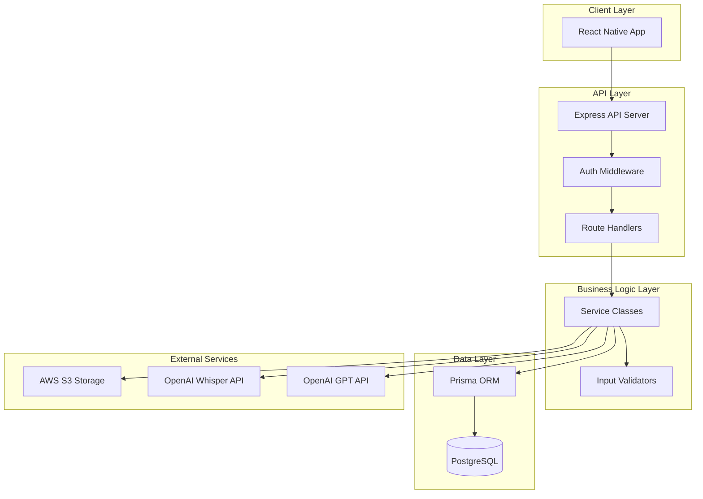

# Design Document: AI Audio Summarization Backend

## Overview

The AI Audio Summarization Backend is a TypeScript/Node.js/Express application that provides RESTful APIs for a React Native interview practice platform. The system transforms audio recordings into AI-powered feedback using OpenAI's Whisper and GPT APIs, while managing user accounts, subscriptions, and performance analytics.

The architecture follows a layered approach with clear separation between API routes, business logic, data access, and external service integrations. The system uses PostgreSQL with Prisma ORM for data persistence and AWS S3 for file storage.

## Architecture

### High-Level Architecture



### System Components

1. **API Server**: Express.js application with TypeScript
2. **Authentication Layer**: JWT-based auth with bcrypt password hashing
3. **Business Services**: Core application logic and external API integration
4. **Data Access Layer**: Prisma ORM with PostgreSQL database
5. **File Storage**: AWS S3 for audio files and resume documents
6. **AI Integration**: OpenAI Whisper for transcription, GPT for analysis

## Components and Interfaces

### Core Service Classes

#### AuthService
```typescript
interface AuthService {
  register(email: string, password: string): Promise<{ user: User; token: string }>;
  login(email: string, password: string): Promise<{ user: User; token: string }>;
  validateToken(token: string): Promise<User>;
  logout(token: string): Promise<void>;
}
```

#### ProfileService
```typescript
interface ProfileService {
  getProfile(userId: string): Promise<UserProfile>;
  updateProfile(userId: string, data: ProfileUpdateData): Promise<UserProfile>;
  uploadResume(userId: string, file: Buffer, filename: string): Promise<string>;
  processResume(userId: string, s3Key: string): Promise<void>;
  setTargetRole(userId: string, industry: string, jobTitle: string): Promise<void>;
}
```

#### AudioSessionService
```typescript
interface AudioSessionService {
  startSession(userId: string): Promise<AudioSession>;
  uploadAudio(sessionId: string, audioBuffer: Buffer): Promise<void>;
  processAudio(sessionId: string): Promise<void>;
  getSessionHistory(userId: string, limit?: number): Promise<AudioSession[]>;
  getSession(sessionId: string): Promise<AudioSession>;
}
```

#### AIService
```typescript
interface AIService {
  transcribeAudio(audioBuffer: Buffer): Promise<string>;
  analyzeResponse(transcript: string, userContext: UserContext): Promise<AIAnalysis>;
  extractResumeData(resumeText: string): Promise<ResumeData>;
  generatePersonalizedPrompt(userProfile: UserProfile): Promise<string>;
}
```

#### DashboardService
```typescript
interface DashboardService {
  getStats(userId: string): Promise<DashboardStats>;
  calculateConfidenceScore(userId: string): Promise<number>;
  getRecentInsights(userId: string): Promise<Insight[]>;
  getPerformanceTrends(userId: string): Promise<PerformanceTrend[]>;
}
```

#### SubscriptionService
```typescript
interface SubscriptionService {
  checkUsageLimit(userId: string): Promise<boolean>;
  incrementUsage(userId: string): Promise<void>;
  upgradeSubscription(userId: string, tier: SubscriptionTier): Promise<void>;
  resetMonthlyUsage(): Promise<void>;
}
```

### API Route Structure

```
/api/auth
  POST /register
  POST /login
  POST /logout
  GET  /me

/api/profile
  GET    /
  PUT    /
  POST   /resume
  PUT    /target-role

/api/sessions
  POST   /start
  POST   /:id/audio
  GET    /history
  GET    /:id

/api/dashboard
  GET    /stats
  GET    /insights
  GET    /trends

/api/admin
  GET    /health
  POST   /reset-usage
```

## Data Models

### Core Database Schema

The system uses the existing Prisma schema with these key models:

#### User Model
```typescript
interface User {
  id: string;
  email: string;
  passwordHash: string;
  subscriptionTier: SubscriptionTier;
  createdAt: Date;
  updatedAt: Date;
}
```

#### UserProfile Model
```typescript
interface UserProfile {
  id: string;
  userId: string;
  resumeS3Key?: string;
  targetIndustry?: string;
  targetJobTitle?: string;
  aiAttributes: Record<string, any>;
  extractedSkills: string[];
  experienceLevel: string;
  createdAt: Date;
  updatedAt: Date;
}
```

#### AudioSession Model
```typescript
interface AudioSession {
  id: string;
  userId: string;
  audioS3Key: string;
  transcript?: string;
  aiAnalysis?: Record<string, any>;
  clarityScore?: number;
  confidenceScore?: number;
  toneScore?: number;
  enthusiasmScore?: number;
  specificityScore?: number;
  status: SessionStatus;
  createdAt: Date;
  updatedAt: Date;
}
```

#### UsageTracking Model
```typescript
interface UsageTracking {
  id: string;
  userId: string;
  month: number;
  year: number;
  sessionCount: number;
  createdAt: Date;
  updatedAt: Date;
}
```

### Data Transfer Objects

#### API Request/Response Types
```typescript
interface RegisterRequest {
  email: string;
  password: string;
}

interface LoginRequest {
  email: string;
  password: string;
}

interface AuthResponse {
  user: {
    id: string;
    email: string;
    subscriptionTier: string;
  };
  token: string;
}

interface ProfileUpdateRequest {
  targetIndustry?: string;
  targetJobTitle?: string;
}

interface DashboardStats {
  confidenceScore: number;
  totalSessions: number;
  averageScores: {
    clarity: number;
    confidence: number;
    tone: number;
    enthusiasm: number;
    specificity: number;
  };
  recentInsights: string[];
  usageThisMonth: number;
  usageLimit: number;
}
```

## Error Handling

### Error Response Format
```typescript
interface ErrorResponse {
  error: {
    code: string;
    message: string;
    details?: any;
  };
  timestamp: string;
  path: string;
}
```

### Error Categories
- **ValidationError**: Invalid input data (400)
- **AuthenticationError**: Invalid credentials or token (401)
- **AuthorizationError**: Insufficient permissions (403)
- **NotFoundError**: Resource not found (404)
- **UsageLimitError**: Subscription limit exceeded (429)
- **ExternalServiceError**: Third-party API failures (502)
- **InternalError**: Unexpected server errors (500)

### Error Handling Strategy
1. **Input Validation**: Joi schemas for request validation
2. **Service Layer**: Try-catch blocks with typed error throwing
3. **Global Handler**: Express error middleware for consistent responses
4. **External APIs**: Retry logic with exponential backoff
5. **Database**: Transaction rollbacks on failures

## Testing Strategy

### Testing Approach

The system will use a dual testing approach combining unit tests and property-based tests for comprehensive coverage.

**Unit Testing**:
- Specific examples and edge cases
- Integration points between components  
- Error conditions and boundary cases
- Mock external dependencies (OpenAI APIs, S3)

**Property-Based Testing**:
- Universal properties that hold across all inputs
- Data integrity and consistency rules
- API contract validation
- Business logic correctness

**Testing Framework**: Jest with ts-jest for TypeScript support
**Property Testing Library**: fast-check for property-based testing
**Test Configuration**: Minimum 100 iterations per property test

Each property test will be tagged with: **Feature: ai-audio-summarization-backend, Property {number}: {property_text}**

### Test Environment Setup
- In-memory SQLite database for unit tests
- Docker containers for integration tests
- Mock implementations for external services
- Test data factories for consistent test data generation

## Correctness Properties

*A property is a characteristic or behavior that should hold true across all valid executions of a system—essentially, a formal statement about what the system should do. Properties serve as the bridge between human-readable specifications and machine-verifiable correctness guarantees.*

Based on the prework analysis of acceptance criteria, the following correctness properties ensure the system behaves correctly across all inputs and scenarios:

### Authentication Properties

**Property 1: User registration creates encrypted accounts**
*For any* valid email and password combination, registering a new user should create a user account with properly encrypted password storage
**Validates: Requirements 1.1**

**Property 2: Valid credentials return JWT tokens**
*For any* valid user credentials, authentication should succeed and return a valid JWT token
**Validates: Requirements 1.2**

**Property 3: Valid tokens authorize access**
*For any* valid JWT token, access should be granted to protected endpoints
**Validates: Requirements 1.3**

**Property 4: Logout invalidates tokens**
*For any* user session, logging out should invalidate the token for all subsequent requests
**Validates: Requirements 1.4**

### Profile Management Properties

**Property 5: Resume upload triggers processing**
*For any* valid resume file (PDF/Word), uploading should store the file in S3 and initiate AI extraction
**Validates: Requirements 2.1**

**Property 6: Resume processing updates profile**
*For any* processed resume, the user profile should be updated with extracted skills, experience, and background data
**Validates: Requirements 2.2**

**Property 7: Target role validation**
*For any* target role input, the system should only accept valid industry and job title combinations
**Validates: Requirements 2.3**

**Property 8: Session analysis stores attributes**
*For any* completed AI analysis, the system should store AI attributes for personalized prompt generation
**Validates: Requirements 2.4**

**Property 9: Profile updates maintain history**
*For any* profile modification, the system should maintain a version history of changes
**Validates: Requirements 2.5**

### Session Management Properties

**Property 10: Session creation returns identifier**
*For any* user starting a recording session, the system should create an Audio_Session record and return a unique session identifier
**Validates: Requirements 3.1**

**Property 11: Audio upload initiates transcription**
*For any* audio file upload, the system should store it in S3 and initiate Whisper API transcription
**Validates: Requirements 3.2**

**Property 12: Transcription triggers analysis**
*For any* completed transcription, the system should trigger AI analysis using GPT API with user context
**Validates: Requirements 3.3**

**Property 13: Analysis produces all scores**
*For any* completed AI analysis, the system should calculate performance scores for all five categories (clarity, confidence, tone, enthusiasm, specificity)
**Validates: Requirements 3.4**

**Property 14: Session completion updates usage**
*For any* completed session, the system should update usage tracking and enforce subscription limits
**Validates: Requirements 3.5**

### AI Analysis Properties

**Property 15: Audio processing includes user context**
*For any* audio processing request, the AI analysis should incorporate user profile data and AI attributes for personalization
**Validates: Requirements 4.1**

**Property 16: Feedback contains required insights**
*For any* generated feedback, the system should produce insights about response quality, content relevance, and delivery
**Validates: Requirements 4.2**

**Property 17: Scores within valid range**
*For any* score calculation, all performance scores should be numerical ratings between 0 and 100 for each category
**Validates: Requirements 4.3**

**Property 18: Analysis results are persisted**
*For any* completed analysis, all feedback and scores should be stored in the Audio_Session record
**Validates: Requirements 4.4**

**Property 19: Prompts use target role context**
*For any* prompt generation, the system should incorporate target role information to provide role-specific guidance
**Validates: Requirements 4.5**

### Dashboard and Analytics Properties

**Property 20: Confidence score calculation consistency**
*For any* dashboard request, the confidence score should be calculated consistently from recent session history
**Validates: Requirements 5.1**

**Property 21: Analytics include all score categories**
*For any* analytics display, performance trends should be provided across all performance score categories
**Validates: Requirements 5.2**

**Property 22: Session history chronological ordering**
*For any* session history request, Audio_Session records should be returned in chronological order with key metrics
**Validates: Requirements 5.3**

**Property 23: Insights from historical patterns**
*For any* user with session history, the system should generate insights based on identified patterns and improvements
**Validates: Requirements 5.4**

**Property 24: Visualization data formatting**
*For any* visualization request, data should be properly formatted for radar charts and performance graphs
**Validates: Requirements 5.5**

### Subscription Management Properties

**Property 25: New users get default tier**
*For any* new user registration, the system should assign the free subscription tier with 3 sessions per month limit
**Validates: Requirements 6.1**

**Property 26: Usage limit verification**
*For any* session start request, the usage tracking should verify the user hasn't exceeded their monthly limit
**Validates: Requirements 6.2**

**Property 27: Limit enforcement blocks sessions**
*For any* user at their usage limit, the system should prevent new session creation and return appropriate error messages
**Validates: Requirements 6.3**

**Property 28: Subscription upgrade removes limits**
*For any* user upgrading to paid tier, the system should update their subscription tier and remove usage restrictions
**Validates: Requirements 6.4**

**Property 29: Monthly reset clears counters**
*For any* monthly period reset, the usage tracking should clear usage counters for all users
**Validates: Requirements 6.5**

### File Storage Properties

**Property 30: Audio files stored with unique identifiers**
*For any* audio file upload, the system should store it in S3 with unique identifiers and proper access controls
**Validates: Requirements 7.1**

**Property 31: Resume documents maintain database references**
*For any* resume document upload, the system should store it in S3 and maintain references in the database
**Validates: Requirements 7.2**

**Property 32: Cleanup procedures manage unused files**
*For any* unused files, the cleanup procedures should properly identify and remove them to manage storage costs
**Validates: Requirements 7.3**

**Property 33: Secure file access URLs**
*For any* file access request, the system should generate secure, time-limited URLs for authorized access only
**Validates: Requirements 7.4**

**Property 34: File operation error handling**
*For any* file operation failure, the system should handle errors gracefully and maintain data consistency
**Validates: Requirements 7.5**

### External API Integration Properties

**Property 35: Whisper API error handling**
*For any* audio file processing, the transcription service should use OpenAI Whisper API with proper error handling and retries
**Validates: Requirements 8.1**

**Property 36: GPT API structured prompts**
*For any* feedback generation, the system should use OpenAI GPT API with structured prompts and response parsing
**Validates: Requirements 8.2**

**Property 37: API failure backoff strategy**
*For any* API call failure, the system should implement exponential backoff and graceful degradation
**Validates: Requirements 8.3**

**Property 38: API response validation**
*For any* API response received, the system should validate and sanitize all data before storage
**Validates: Requirements 8.4**

**Property 39: Rate limit handling**
*For any* rate limit encounter, the system should queue requests and notify users of delays
**Validates: Requirements 8.5**

### Security Properties

**Property 40: Password encryption with bcrypt**
*For any* user password storage, the system should use bcrypt hashing with appropriate salt rounds
**Validates: Requirements 9.1**

**Property 41: JWT token security**
*For any* JWT token operation, the system should implement secure generation, validation, and expiration
**Validates: Requirements 9.2**

**Property 42: Data access authorization**
*For any* user data access, the system should enforce proper authorization and data isolation
**Validates: Requirements 9.3**

**Property 43: Secure logging practices**
*For any* system event logging, the system should exclude sensitive information while maintaining audit trails
**Validates: Requirements 9.4**

**Property 44: Complete data deletion**
*For any* user data deletion request, the system should remove all associated records and files
**Validates: Requirements 9.5**

### System Configuration Properties

**Property 45: Configuration loading on startup**
*For any* system startup, the system should load configuration from environment variables and SystemSetting records
**Validates: Requirements 10.1**

**Property 46: Request metrics logging**
*For any* request processing, the system should log performance metrics and error rates
**Validates: Requirements 10.2**

**Property 47: System limit alerting**
*For any* system limit approach, the system should alert administrators and implement protective measures
**Validates: Requirements 10.3**

**Property 48: Runtime configuration updates**
*For any* configuration change need, the system should support runtime updates without service interruption
**Validates: Requirements 10.4**

**Property 49: Health monitoring endpoints**
*For any* health monitoring request, the system should provide endpoints for health checks and status reporting
**Validates: Requirements 10.5**
## Error Handling

### Error Handling Strategy

The system implements a comprehensive error handling strategy with consistent error responses, proper logging, and graceful degradation:

#### Global Error Middleware
```typescript
interface ErrorHandler {
  handleError(error: Error, req: Request, res: Response, next: NextFunction): void;
  logError(error: Error, context: RequestContext): void;
  formatErrorResponse(error: Error): ErrorResponse;
}
```

#### Error Classification
- **ValidationError**: Input validation failures (400 Bad Request)
- **AuthenticationError**: Invalid credentials or expired tokens (401 Unauthorized)  
- **AuthorizationError**: Insufficient permissions (403 Forbidden)
- **NotFoundError**: Resource not found (404 Not Found)
- **UsageLimitError**: Subscription limits exceeded (429 Too Many Requests)
- **ExternalServiceError**: Third-party API failures (502 Bad Gateway)
- **InternalError**: Unexpected server errors (500 Internal Server Error)

#### Retry and Circuit Breaker Patterns
- **OpenAI API calls**: Exponential backoff with jitter (max 3 retries)
- **S3 operations**: Simple retry with linear backoff (max 2 retries)
- **Database operations**: Transaction rollback on failures
- **Circuit breaker**: Fail-fast when external services are consistently failing

#### Error Recovery Strategies
- **Partial failures**: Continue processing other operations when possible
- **Graceful degradation**: Provide limited functionality when external services fail
- **User notification**: Clear error messages with actionable guidance
- **Admin alerting**: Critical errors trigger immediate notifications

## Testing Strategy

### Comprehensive Testing Approach

The system uses a dual testing approach combining unit tests and property-based tests for comprehensive coverage:

**Unit Testing Focus**:
- Specific examples demonstrating correct behavior
- Integration points between service layers
- Edge cases and error conditions
- Mock external dependencies (OpenAI APIs, S3, database)

**Property-Based Testing Focus**:
- Universal properties that hold across all inputs
- Business logic correctness validation
- Data integrity and consistency rules
- API contract validation across input ranges

**Testing Framework Configuration**:
- **Framework**: Jest with ts-jest for TypeScript support
- **Property Testing**: fast-check library for property-based testing
- **Test Database**: In-memory SQLite for unit tests, Docker PostgreSQL for integration
- **Mock Services**: Custom mocks for OpenAI APIs and AWS S3
- **Property Test Configuration**: Minimum 100 iterations per property test

**Test Organization**:
```
tests/
├── unit/
│   ├── services/
│   ├── routes/
│   └── utils/
├── integration/
│   ├── api/
│   └── database/
├── properties/
│   ├── auth.properties.test.ts
│   ├── sessions.properties.test.ts
│   └── subscriptions.properties.test.ts
└── fixtures/
    ├── users.ts
    ├── sessions.ts
    └── profiles.ts
```

**Property Test Tagging**:
Each property test must be tagged with a comment referencing its design document property:
```typescript
// Feature: ai-audio-summarization-backend, Property 1: User registration creates encrypted accounts
```

**Test Data Management**:
- Factory functions for consistent test data generation
- Realistic test data that covers edge cases
- Separate test data sets for unit vs integration tests
- Property test generators for randomized input validation

**Coverage Requirements**:
- Unit tests: 90% code coverage minimum
- Property tests: All 49 correctness properties implemented
- Integration tests: All API endpoints covered
- End-to-end tests: Critical user workflows validated

**Continuous Integration**:
- All tests run on every pull request
- Property tests run with extended iteration counts in CI
- Performance regression tests for critical paths
- Database migration tests in staging environment