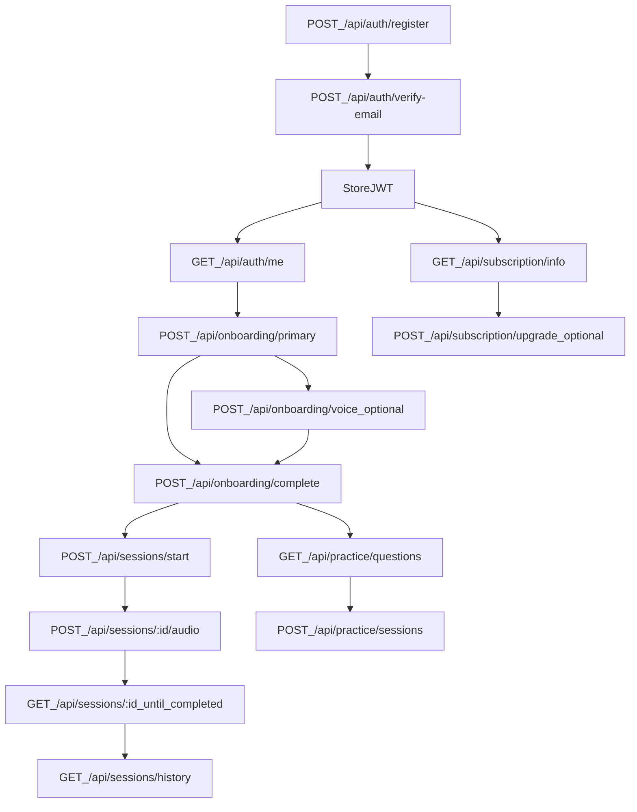

# Frontend API (Consolidated)

This doc is intended for frontend integration. It is based on the current Express routes under `src/routes/` and the current validation rules in `src/middleware/validation.ts`.

## Base URL

- **Base**: `/api`
- **Health**: `GET /api/health`

## Authentication

Authenticated endpoints require:

```http
Authorization: Bearer <access_token>
```

### Response conventions (important)

- Many successful endpoints return:
  - `{ success: true, message?: string, data?: object }`
- Some endpoints return **raw JSON without** `{ success: true }` (notably `GET /api/auth/me`).
- Error responses usually return:

```json
{
  "error": { "code": "ERROR_CODE", "message": "Human readable message", "details": ["optional"] },
  "timestamp": "2026-04-23T00:00:00.000Z",
  "path": "/api/..."
}
```

## Core

### GET `/api`

Returns a JSON index of endpoints (not OpenAPI).

**200 response**

```json
{
  "success": true,
  "message": "AI Audio Summarization Backend API",
  "version": "1.0.0",
  "endpoints": { "auth": {}, "profile": {}, "sessions": {} },
  "documentation": "See design document for detailed API specifications"
}
```

### GET `/api/health`

**200 response**

```json
{
  "success": true,
  "message": "API is healthy",
  "timestamp": "2026-04-23T00:00:00.000Z",
  "version": "1.0.0"
}
```

---

## Auth (`/api/auth`)

### POST `/api/auth/register`

**Body**

```json
{ "email": "user@acme.com", "password": "StrongPass1!" }
```

**201 response**

```json
{
  "success": true,
  "message": "Account created. Check your email for a verification code.",
  "data": {
    "user": {
      "id": "cxxxxxxxxxxxxxxxxxxxxxxxx",
      "email": "user@acme.com",
      "subscriptionTier": "FREE",
      "emailVerified": false,
      "pendingEmail": null,
      "onboardingCompletedAt": null,
      "createdAt": "2026-04-23T00:00:00.000Z",
      "updatedAt": "2026-04-23T00:00:00.000Z"
    }
  }
}
```

**400 example (validation)**

```json
{
  "error": {
    "code": "VALIDATION_ERROR",
    "message": "Request validation failed",
    "details": ["Body: \"email\" is required"]
  },
  "timestamp": "2026-04-23T00:00:00.000Z",
  "path": "/register"
}
```

### POST `/api/auth/verify-email`

**Body**

```json
{ "email": "user@acme.com", "otp": "123456" }
```

**200 response**

```json
{
  "success": true,
  "message": "Email verified successfully",
  "data": {
    "user": { "id": "cxxxxxxxxxxxxxxxxxxxxxxxx", "email": "user@acme.com", "emailVerified": true },
    "token": "<jwt>"
  }
}
```

### POST `/api/auth/resend-verification`

**Body**

```json
{ "email": "user@acme.com" }
```

**200 response**

```json
{
  "success": true,
  "message": "If an account exists and needs verification, you will receive an email."
}
```

### POST `/api/auth/login`

**Body**

```json
{ "email": "user@acme.com", "password": "StrongPass1!" }
```

**200 response**

```json
{
  "success": true,
  "message": "Login successful",
  "data": {
    "user": { "id": "cxxxxxxxxxxxxxxxxxxxxxxxx", "email": "user@acme.com", "emailVerified": true },
    "token": "<jwt>"
  }
}
```

**403 example (email not verified)**

```json
{
  "error": { "code": "EMAIL_NOT_VERIFIED", "message": "Email not verified" },
  "timestamp": "2026-04-23T00:00:00.000Z",
  "path": "/login"
}
```

### POST `/api/auth/logout` (auth)

**Headers**
- `Authorization: Bearer <jwt>`

**200 response**

```json
{ "success": true, "message": "Logout successful" }
```

**400 example (missing token header)**

```json
{
  "error": { "code": "MISSING_TOKEN", "message": "Authorization token is required" },
  "timestamp": "2026-04-23T00:00:00.000Z",
  "path": "/logout"
}
```

### GET `/api/auth/me` (auth)

**Headers**
- `Authorization: Bearer <jwt>`

**200 response (not wrapped)**

```json
{
  "id": "cxxxxxxxxxxxxxxxxxxxxxxxx",
  "email": "user@acme.com",
  "subscriptionTier": "FREE",
  "emailVerified": true,
  "pendingEmail": null,
  "onboardingCompletedAt": null,
  "createdAt": "2026-04-23T00:00:00.000Z",
  "updatedAt": "2026-04-23T00:00:00.000Z"
}
```

### POST `/api/auth/refresh`

**Body (validated)**

```json
{ "refreshToken": "<token>" }
```

**200 response**

```json
{
  "success": true,
  "message": "Token refreshed successfully",
  "data": { "token": "<new-jwt>" }
}
```

**Behavior note**: The backend currently validates the provided `refreshToken` as a JWT and re-issues a new token (no separate refresh-token rotation/store).

### POST `/api/auth/google`

**Body**

```json
{ "idToken": "<google_id_token>" }
```

**200 response**

```json
{
  "success": true,
  "message": "Login successful",
  "data": { "user": { "id": "c...", "email": "user@gmail.com" }, "token": "<jwt>" }
}
```

### POST `/api/auth/forgot-password`

**Body**

```json
{ "email": "user@acme.com" }
```

**200 response**

```json
{
  "success": true,
  "message": "If an account exists with this email, you will receive a password reset code."
}
```

### POST `/api/auth/verify-otp`

**Body**

```json
{ "email": "user@acme.com", "otp": "123456" }
```

**200 response**

```json
{ "success": true, "message": "OTP verified successfully", "resetToken": "<reset_token>" }
```

### POST `/api/auth/reset-password`

**Body**

```json
{ "resetToken": "<reset_token>", "newPassword": "NewStrong1!" }
```

**200 response**

```json
{ "success": true, "message": "Password reset successfully" }
```

### POST `/api/auth/change-password` (auth)

**Body**

```json
{ "currentPassword": "OldStrong1!", "newPassword": "NewStrong1!" }
```

**200 response**

```json
{ "success": true, "message": "Password changed successfully" }
```

### POST `/api/auth/change-email/request` (auth)

**Body**

```json
{ "newEmail": "new@acme.com", "password": "StrongPass1!" }
```

**200 response**

```json
{
  "success": true,
  "message": "Check your new email for a confirmation code.",
  "user": { "id": "c...", "email": "user@acme.com", "pendingEmail": "new@acme.com" }
}
```

### POST `/api/auth/change-email/confirm` (auth)

**Body**

```json
{ "otp": "123456" }
```

**200 response**

```json
{
  "success": true,
  "message": "Email updated successfully",
  "data": { "user": { "id": "c...", "email": "new@acme.com" }, "token": "<new-jwt>" }
}
```

### POST `/api/auth/change-email/resend` (auth)

**Body**

```json
{}
```

**200 response**

```json
{ "success": true, "message": "If you have a pending email change, a new code was sent." }
```

### GET `/api/auth/validate` (auth)

**200 response**

```json
{
  "success": true,
  "message": "Token is valid",
  "user": { "id": "c...", "email": "user@acme.com", "subscriptionTier": "FREE", "emailVerified": true, "pendingEmail": null }
}
```

---

## Onboarding (`/api/onboarding`) (auth + verified email)

> All onboarding endpoints require a verified email and will typically return `409` if onboarding is already completed.

### POST `/api/onboarding/primary`

**Content-Type**: `multipart/form-data` *or* `application/json`

Provide **exactly one** of:
- **Resume file**: `resume` (PDF/DOC/DOCX)
- **Manual profile**:
  - JSON body containing profile fields, or
  - multipart fields `manualProfile` or `profile` containing a JSON string

**200 response**

```json
{ "success": true, "message": "Primary onboarding step saved", "data": { "id": "c...", "userId": "c...", "updatedAt": "..." } }
```

**400 example (both resume + manual provided)**

```json
{
  "error": { "code": "VALIDATION_ERROR", "message": "Provide exactly one of: resume file or manual profile, not both" },
  "timestamp": "2026-04-23T00:00:00.000Z",
  "path": "/primary"
}
```

### POST `/api/onboarding/voice` (or `/api/onboarding/primary/voice`)

**Content-Type**: `multipart/form-data`

- Upload **one audio file** (any field name works; recommended `audio`)

**200 response**

```json
{ "success": true, "message": "Voice intro processed", "data": { "id": "c...", "userId": "c...", "aiAttributes": { "introductionTranscript": "..." } } }
```

### POST `/api/onboarding/complete`

**200 response**

```json
{ "success": true, "message": "Onboarding complete", "data": { "id": "c...", "userId": "c..." } }
```

---

## Profile (`/api/profile`) (auth + verified email)

### GET `/api/profile`

**200 response**

```json
{ "success": true, "data": { "id": "c...", "userId": "c...", "fullName": "Ada Lovelace", "aiAttributes": {} } }
```

### PUT `/api/profile`

At least one field required.

**Body (all optional)**

```json
{
  "fullName": "Ada Lovelace",
  "currentJobTitle": "Engineer",
  "currentCompany": "Acme",
  "school": "Example University",
  "degreeInfo": "BS Computer Science",
  "previousJobTitles": ["Intern"],
  "targetIndustry": "Software",
  "targetJobTitle": "Backend Engineer",
  "experienceLevel": "Mid"
}
```

**200 response**

```json
{ "success": true, "data": { "id": "c...", "fullName": "Ada Lovelace" }, "message": "Profile updated successfully" }
```

### POST `/api/profile/manual-entry`

Same shape as `PUT /api/profile`, but `fullName` is required.

**200 response**

```json
{ "success": true, "data": { "id": "c...", "fullName": "Ada Lovelace" }, "message": "Profile information saved successfully" }
```

### POST `/api/profile/resume`

**Content-Type**: `multipart/form-data`

- File field: `resume` (PDF/DOC/DOCX, max 10MB)

**200 response**

```json
{
  "success": true,
  "data": { "resumeS3Key": "s3/key", "filename": "resume.pdf", "size": 12345 },
  "message": "Resume uploaded successfully"
}
```

### GET `/api/profile/resume/url`

**Query**
- `expiresIn` (optional seconds, `1..86400`, default `3600`)

**200 response**

```json
{
  "success": true,
  "data": { "url": "https://presigned...", "expiresIn": 3600, "expiresAt": "2026-04-23T01:00:00.000Z" },
  "message": "Resume URL generated successfully"
}
```

### PUT `/api/profile/target-role`

**Body**

```json
{ "targetIndustry": "Software", "targetJobTitle": "Backend Engineer" }
```

**200 response**

```json
{ "success": true, "message": "Target role updated successfully" }
```

### DELETE `/api/profile`

**200 response**

```json
{ "success": true, "message": "Profile deleted successfully" }
```

### GET `/api/profile/ai-attributes`

**200 response**

```json
{ "success": true, "data": { "personalizationContext": {}, "introductionTranscript": "..." } }
```

---

## Sessions (`/api/sessions`) (auth + verified email)

### POST `/api/sessions/start`

**201 response**

```json
{ "success": true, "data": { "sessionId": "cxxxxxxxxxxxxxxxxxxxxxxxx", "status": "pending", "createdAt": "2026-04-23T00:00:00.000Z" } }
```

**429 example (usage limit)**

```json
{
  "error": { "code": "USAGE_LIMIT_EXCEEDED", "message": "Usage limit exceeded" },
  "timestamp": "2026-04-23T00:00:00.000Z",
  "path": "/start"
}
```

### POST `/api/sessions/:id/audio`

**Content-Type**: `multipart/form-data`

- File field: `audio` (MP3/WAV/MP4/WebM; max ~50MB)

**200 response**

```json
{ "success": true, "message": "Audio uploaded successfully. Processing started.", "data": { "id": "c...", "status": "processing" } }
```

### POST `/api/sessions/:id/assembly-sync`

Used to sync/attach AssemblyAI job state to an existing session.

**200 response**: `{ success: true, ... }` (shape depends on `audioSessionService`)

### GET `/api/sessions/history`

**Query**
- `limit` (1..100)
- `offset` (>=0)
- `status`: `completed|processing|failed|pending|transcribing|awaiting_review|analyzing|all`
- `sessionType`: `interview|practice|all`

**200 response**

```json
{
  "success": true,
  "data": {
    "sessions": [{ "id": "c...", "displayName": null, "status": "completed", "createdAt": "...", "updatedAt": "..." }],
    "total": 1,
    "filter": { "status": "completed", "sessionType": "all" }
  }
}
```

### PATCH `/api/sessions/:id/transcript`

**Important**: The current validator expects `transcript` to be an **array of turns**, not a string.

**Body**

```json
{
  "transcript": [
    { "id": 0, "s": "interviewer", "t": "Tell me about yourself.", "start": 0, "end": 2100 },
    { "id": 1, "s": "candidate", "t": "Sure—I'm a backend engineer...", "start": 2200, "end": 8100 }
  ]
}
```

**200 response**

```json
{
  "success": true,
  "message": "Analysis complete.",
  "data": {
    "id": "c...",
    "status": "completed",
    "aiAnalysis": {},
    "scores": { "overall": 0.7, "clarity": 0.8, "confidence": 0.6, "specificity": 0.7, "tone": 0.7, "enthusiasm": 0.6 },
    "updatedAt": "2026-04-23T00:00:00.000Z"
  }
}
```

### PATCH `/api/sessions/:id`

**Body**

```json
{ "displayName": "Mock interview (Google)" }
```

**200 response**

```json
{ "success": true, "message": "Session display name updated", "data": { "id": "c...", "displayName": "Mock interview (Google)", "updatedAt": "..." } }
```

### GET `/api/sessions/:id`

**200 response**

```json
{
  "success": true,
  "data": {
    "id": "c...",
    "displayName": null,
    "status": "completed",
    "transcript": "...",
    "aiAnalysis": {},
    "scores": { "overall": 0.7, "clarity": 0.8, "confidence": 0.6, "specificity": 0.7, "tone": 0.7, "enthusiasm": 0.6 },
    "analysisComplete": true,
    "processingError": null,
    "createdAt": "...",
    "updatedAt": "..."
  }
}
```

### GET `/api/sessions/:id/audio-url`

**200 response**

```json
{ "success": true, "data": { "url": "https://presigned...", "expiresIn": 3600, "expiresAt": "..." } }
```

---

## Practice (`/api/practice`) (auth + verified email)

### GET `/api/practice/questions`

**Query**
- `refresh` (optional): `true|false`

**200 response**

`data.sections` is ordered: **AI recommended** (OpenAI), **behavioral** (random from static pool), **technical** (OpenAI from profile / target role). Each section has three `{ index, text }` items (`index` is 0–2 within that section).

```json
{
  "success": true,
  "data": {
    "sections": [
      {
        "key": "ai_recommended",
        "title": "AI recommended questions",
        "questions": [{ "index": 0, "text": "..." }, { "index": 1, "text": "..." }, { "index": 2, "text": "..." }]
      },
      {
        "key": "behavioral",
        "title": "Behavioral questions",
        "questions": [{ "index": 0, "text": "..." }, { "index": 1, "text": "..." }, { "index": 2, "text": "..." }]
      },
      {
        "key": "domain",
        "title": "Technical questions",
        "questions": [{ "index": 0, "text": "..." }, { "index": 1, "text": "..." }, { "index": 2, "text": "..." }]
      }
    ],
    "personalized": true
  }
}
```

### POST `/api/practice/sessions`

**Content-Type**: `multipart/form-data`

- File field: `audio`
- Text fields:
  - `question` (required)
  - `questionIndex` (optional; defaults to 0)

**201 response**

```json
{
  "success": true,
  "message": "Practice session complete.",
  "data": {
    "id": "c...",
    "sessionType": "practice",
    "displayName": null,
    "status": "completed",
    "transcript": "...",
    "aiAnalysis": {},
    "scores": {},
    "createdAt": "..."
  }
}
```

**400 example (missing question)**

```json
{
  "error": { "code": "MISSING_QUESTION", "message": "question field is required" },
  "timestamp": "2026-04-23T00:00:00.000Z",
  "path": "/sessions"
}
```

### PATCH `/api/practice/sessions/:id`

**Body**

```json
{ "transcript": "Edited full transcript text..." }
```

**200 response**

```json
{ "success": true, "message": "Analysis complete.", "data": { "id": "c...", "updatedAt": "..." } }
```

---

## Subscription (`/api/subscription`) (auth + verified email)

### GET `/api/subscription/info`

**200 response**

```json
{ "success": true, "data": { "tier": "FREE", "currentUsage": 2, "limit": 5, "canCreateSession": true } }
```

### POST `/api/subscription/upgrade`

**Body**

```json
{ "tier": "PAID" }
```

**200 response**

```json
{ "success": true, "message": "Subscription upgraded to PAID tier successfully", "data": { "tier": "PAID" } }
```

---

## Dashboard (`/api/dashboard`) (auth + verified email)

### GET `/api/dashboard/stats`

**200 response**

```json
{ "success": true, "data": { "totalSessions": 0, "avgOverallScore": 0 } }
```

### GET `/api/dashboard/insights?limit=10`

**200 response**

```json
{ "success": true, "data": [] }
```

### GET `/api/dashboard/trends?days=30`

**200 response**

```json
{ "success": true, "data": [] }
```

> The exact shapes for dashboard data come from `DashboardService` (not repeated here), but all three endpoints return `{ success: true, data: ... }`.

---

## Webhooks (`/api/webhooks`)

### POST `/api/webhooks/assemblyai`

**Auth**: protected by a secret header (verified by `verifyAssemblyWebhookAuth`).

**Body**: AssemblyAI webhook payload (varies by event).

**200 response**

```json
{ "success": true }
```

---

## Admin (`/api/admin`) (auth + admin-only; conditional)

Admin routes exist only when `ENABLE_ADMIN_ENDPOINTS` is enabled on the server.

- GET `/api/admin/health`
- GET `/api/admin/metrics`
- POST `/api/admin/reset-usage`
- GET `/api/admin/users`
- GET `/api/admin/system-config`
- GET `/api/admin/error-handling`
- POST `/api/admin/circuit-breaker/:serviceName/reset`
- POST `/api/admin/degradation/:serviceName/deactivate`
- GET `/api/admin/system-integration`
- GET `/api/admin/service-dependencies`
- POST `/api/admin/test-request-flow`

---

## Integration flow (recommended sequence)



